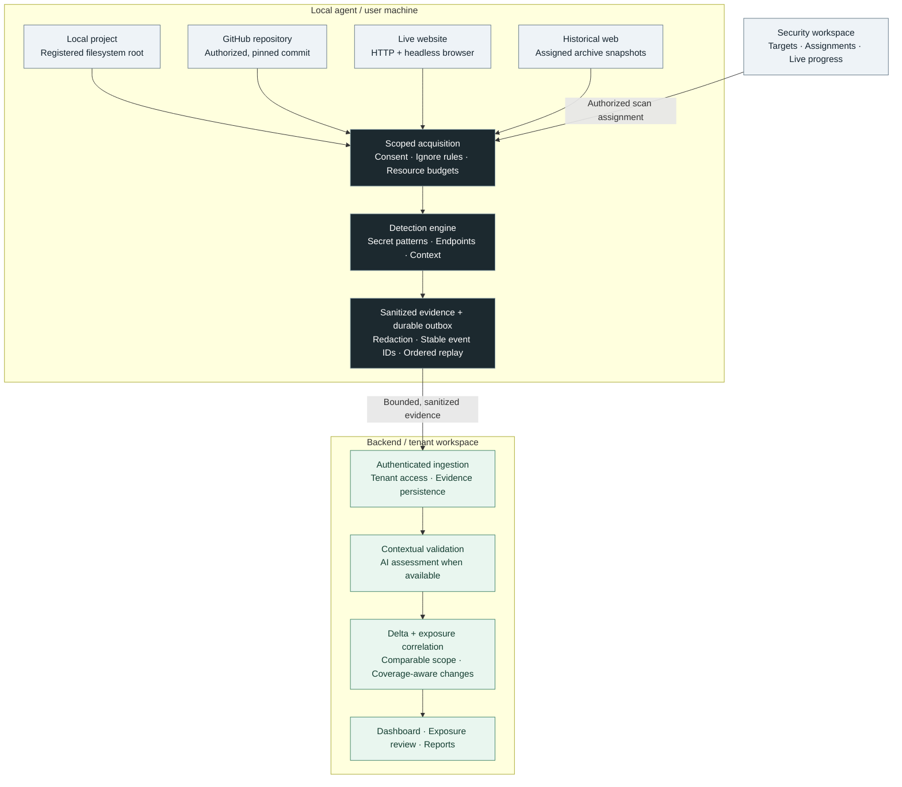

<p align="center">
  
</p>

<p align="center">
  <strong>The local scanning runtime for the LeakHunterX security workspace.</strong><br>
  Configure scans in the dashboard. Run acquisition and detection on your machine.<br>
  Review contextual findings, validation, Delta and reports in one workspace.
</p>

<p align="center">
  <a href="#quick-start">Quick start</a> ·
  <a href="#architecture">Architecture</a> ·
  <a href="#commands">Commands</a> ·
  <a href="#documentation">Documentation</a> ·
  <a href="https://github.com/Omkar443/leakhunterx-agent/issues">Issues</a>
</p>

<p align="center">
  <strong>Python 3.10+</strong> &nbsp; / &nbsp;
  <strong>Linux · Windows · macOS</strong> &nbsp; / &nbsp;
  <strong>MIT</strong> &nbsp; / &nbsp;
  <strong>Source: 1.1.0rc10</strong>
</p>

## One runtime. Multiple sources.

| Source | What runs on the agent |
| --- | --- |
| **Local projects** | Supported text files inside a registered root, respecting `.lhxignore`, filesystem boundaries and scan budgets. |
| **GitHub repositories** | Authorized repository acquisition at a pinned commit, using the same local detection pipeline. |
| **Live websites** | Scoped host and page discovery, served HTML/text, headless browser assets and literal JavaScript dependencies. |
| **Historical exposure** | Assigned archive snapshots, bounded source recovery and historical provenance kept distinct from current exposure. |

Secret candidates and endpoints retain context and source provenance. The agent
journals sanitized evidence before delivery, retries interrupted transfers and
keeps completion behind its pending evidence. The backend coordinates workspace
access, validation, Delta, exposure review and reporting.

## Quick start

### 1. Install the current source

```bash
git clone https://github.com/Omkar443/leakhunterx-agent.git
cd leakhunterx-agent
git switch main
python -m venv .venv
```

Activate the environment for your operating system:

```bash
# Linux / macOS
source .venv/bin/activate
```

```powershell
# Windows PowerShell
.\.venv\Scripts\Activate.ps1
```

```bash
python -m pip install .
```

Install this release candidate with `python -m pip install "leakhunterx-agent==1.1.0rc10"`.
Selecting the exact candidate avoids enabling prereleases for unrelated dependencies.
Connect using `lhx auth`, then run `lhx agent`.

This candidate isolates Git acquisition attempts so interrupted downloads cannot
block subsequent scans. Browser memory accounting avoids charging shared Chromium
pages repeatedly on Linux. During discovery the terminal shows live resource
counts; the percentage bar starts when analysis begins.
Local checkpoints use concurrent-reader storage and short atomic writes, keeping
heartbeat and configuration checks independent of analysis and evidence delivery.

For opt-in background operation on Linux, stop the foreground agent, then use
`lhx service install` and `lhx service start`. Inspect it with `lhx service status`
and `lhx service logs`; stop or remove it with `lhx service stop` / `uninstall`.
Run these as your registered non-root user, without sudo. Installation does not
start a service or copy credentials. See [Python installation, Linux prerequisites
and PyPI publication](https://github.com/Omkar443/leakhunterx-agent/blob/v1.1.0rc10/docs/pypi-and-service.md) for setup and release requirements.
Check their version: packages and downloaded binaries may precede the source on
`main`. This source is a release candidate; a main-branch push does not publish a
stable package or certify final [release acceptance](https://github.com/Omkar443/leakhunterx-agent/blob/v1.1.0rc10/docs/agent-v1-audit.md).

### 2. Connect your workspace

In your production workspace, open **Agents**, generate a connection token, then:

```bash
lhx auth
```

Paste the token at the hidden prompt. Successful registration starts the agent.
The default backend is **`https://backend-leakhunterx.onrender.com`**.

### 3. Start a scan

Keep the agent running. In the dashboard, choose **New scan**, configure an
authorized target and select your connected agent. Progress and delivered evidence
appear in the workspace. For subsequent starts:

```bash
lhx agent
```

Use `lhx status` for a read-only connection check; stop the runtime with Ctrl+C.
Local sources require explicit [target registration](#local-targets-and-offline-scans).
GitHub sources require [repository authorization](https://github.com/Omkar443/leakhunterx-agent/blob/v1.1.0rc10/docs/github-scanning.md).

<details>
<summary><strong>Browser runtime, standalone builds and staging connections</strong></summary>

HTTP crawling and headless rendering are enabled together by default. Python
installations prepare the matching browser cache on first startup; this requires
internet access and supported Chromium system libraries. Later starts reuse the
cache. If rendering is unavailable, HTTP acquisition continues with a recorded
coverage limitation. The browser sandbox is never disabled.

Standalone Linux x64 and Windows x64 builds are available **when published** on
the [releases page](https://github.com/Omkar443/leakhunterx-agent/releases). They
bundle the matching Chromium runtime and do not require Python. macOS uses the
Python installation; a macOS standalone binary is not currently built.

Staging and production registrations are separate. Generate a production token
and run `lhx auth` again when moving from staging. Remove any staging
`LHX_BACKEND_URL` override before starting the production runtime. Updating the
code does not delete an existing credential file.

</details>

## Architecture

**Control in the workspace. Acquisition and detection on the agent.**


<details>
<summary><strong>View the editable architecture diagram</strong></summary>



</details>

| Boundary | Contract |
| --- | --- |
| **Source → agent** | Acquire only authorized assets. Private repository and local source remain on the machine. Repository code is not executed. |
| **Agent → backend** | Deliver bounded, sanitized findings and semantic observations. Public web evidence may include a redacted source excerpt. |
| **Validation → results** | Preserve assessment status and uncertainty. AI unavailability does not turn a detection into a confirmed finding or break a scan. |
| **Scan → Delta** | Compare compatible scans. Failed or cancelled scans do not publish partial detections into dashboard totals or reports. Incomplete coverage does not prove remediation. |

Detected raw secrets are redacted before delivery. Managed GitHub assignments use
temporary, repository-scoped credentials held in agent memory. AI confidence is
an assessment of the available evidence, not proof that a credential is active
or exploitable. See [evidence delivery](https://github.com/Omkar443/leakhunterx-agent/blob/v1.1.0rc10/docs/EVIDENCE_DELIVERY.md) for the protocol.

## Commands

| Command | Purpose | Current options |
| --- | --- | --- |
| `lhx auth` | Register and start the runtime | `--backend https://…`; token entered at the hidden prompt |
| `lhx agent` | Listen for dashboard assignments | `--backend`, `--browser on\|off`, `--log-level`, `--log-file` |
| `lhx status` | Inspect connection status | `--backend`, `--json` |
| `lhx project` | Manage authorized local/repository targets | `add`, `list`, `allow-dashboard`, `deny-dashboard`, `remove` |
| `lhx scan <target>` | Run a scan from the terminal | Local/repository: `--local-only`, `--profile quick\|standard\|deep`, `--json` |
| `lhx resume <scan-id>` | Resume a supported interrupted scan | `--json` |
| `lhx ci` | Request a scan through an existing CI policy | `--commit`, `--policy-id`; optional `--backend`, `--request-id`, `--timeout` |

```bash
lhx status --json
lhx agent --log-level DEBUG --log-file agent.log
lhx scan ./project --local-only --profile deep --json
lhx ci --commit <default-branch-sha> --policy-id <policy-uuid>
```

Use `lhx <command> --help` for the complete syntax. `lhx start` aliases `lhx agent`;
`lhx-agent` remains a compatibility entry point. CI reads its credential from
`LHX_CI_TOKEN`, not command-line arguments, and defaults to the production backend.

`lhx agent --browser off` explicitly limits browser coverage while HTTP crawling
continues. Live website scans reject local-only, profile and JSON flags rather
than silently ignoring them.

## Local targets and offline scans

Create a project in the workspace, then register and explicitly authorize its
machine-local target:

```bash
lhx project add ./project --name Application --project-id <project-id>
lhx project list
lhx project allow-dashboard <target-id>
lhx agent
```

For an offline scan without cloud, AI, browser or provider requests:

```bash
lhx scan ./project --local-only
lhx scan ./project --local-only --json
lhx resume <scan-id> --json
```

Use `.lhxignore` for explicit local exclusions; start from [the example](.lhxignore.example).
Scan only assets you are authorized to assess. Resource budgets protect the host
and target; skipped assets remain visible in coverage.

## Documentation

| Guide | What it covers |
| --- | --- |
| [Local scanning](https://github.com/Omkar443/leakhunterx-agent/blob/v1.1.0rc10/docs/local-scanning.md) | Target consent, profiles, exclusions and offline operation |
| [GitHub scanning](https://github.com/Omkar443/leakhunterx-agent/blob/v1.1.0rc10/docs/github-scanning.md) | Web UI setup, repository authorization and commit-pinned scans |
| [Historical exposure](https://github.com/Omkar443/leakhunterx-agent/blob/v1.1.0rc10/docs/historical-exposure.md) | Archive provenance, source recovery and historical findings |
| [Browser rendering](https://github.com/Omkar443/leakhunterx-agent/blob/v1.1.0rc10/docs/BROWSER_RENDERING.md) | Runtime preparation, sandboxing and coverage |
| [Evidence delivery](https://github.com/Omkar443/leakhunterx-agent/blob/v1.1.0rc10/docs/EVIDENCE_DELIVERY.md) | Redaction, durable delivery and recovery boundaries |
| [Release readiness](https://github.com/Omkar443/leakhunterx-agent/blob/v1.1.0rc10/docs/agent-v1-audit.md) | Automated results and remaining acceptance checks |

## Contributing and verification

```bash
python -m pip install -e . pytest
python -m pytest tests -q
python benchmarks/run.py --check --output benchmarks/results/local.json
python benchmarks/run.py --external --check --output benchmarks/results/external-local.json
```

Real browser integration tests require installed, sandboxed Chromium and
`LHX_TEST_BROWSER=1`. Benchmark scores apply to the labelled synthetic corpus,
not arbitrary production sites. The [audit](https://github.com/Omkar443/leakhunterx-agent/blob/v1.1.0rc10/docs/agent-v1-audit.md) records measured
results and remaining hosted, soak and package acceptance checks.

<details>
<summary><strong>Build standalone binaries and understand the release gate</strong></summary>

Build binaries on their destination operating system:

```bash
python -m pip install . pyinstaller
python packaging/build.py
python packaging/browser_smoke.py dist/<binary-name>
```

The release workflow verifies tests and benchmarks before building artifacts.
Manual builds and candidate tags produce downloadable workflow artifacts.
Stable publication requires completed acceptance evidence and the main-branch
release guard. Pushing to `main` alone does not publish a release.

</details>

---

[MIT license](LICENSE) · [Report an issue](https://github.com/Omkar443/leakhunterx-agent/issues) · [Browse releases](https://github.com/Omkar443/leakhunterx-agent/releases)
