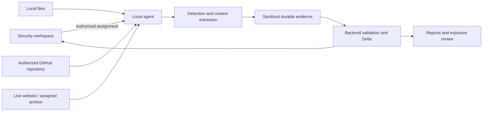

<p align="center">
  
</p>

# LeakHunterX Agent

The local scanning runtime for LeakHunterX. Connect an agent, configure a target
in the security workspace, and start a scan from the web UI. The agent handles
acquisition and detection; the backend handles validation, Delta, reports and
workspace access.

**Current source version:** `1.1.0rc1` · **Python:** 3.10+ · **License:** MIT.
Source promotion to `main` does not publish a stable package or certify final
release acceptance. See [release readiness](docs/agent-v1-audit.md).

## Production connection

The default backend for both registration and runtime is:

```text
https://backend-leakhunterx.onrender.com
```

Open your production LeakHunterX workspace, go to **Agents**, generate a connection
token, and run:

```bash
lhx auth
```

Paste the token at the hidden prompt. Successful registration starts the agent.
For subsequent starts and a read-only status check:

```bash
lhx agent
lhx status
lhx status --json
```

Current connection/runtime options:

| Command | Options |
| --- | --- |
| `lhx auth` | `--backend https://…` (token stays in the hidden prompt) |
| `lhx agent` / `lhx start` | `--backend`, `--browser on\|off`, `--log-level`, `--log-file` |
| `lhx status` | `--backend`, `--json` |
| `lhx scan` | `--local-only`, `--profile quick\|standard\|deep`, `--json` for local/repository scans |
| `lhx ci` | `--commit`, `--policy-id`, optional `--backend`, `--request-id`, `--timeout` |

```bash
lhx agent --log-level DEBUG --log-file agent.log
lhx agent --browser off
lhx scan ./project --local-only --profile deep --json
lhx ci --commit <default-branch-sha> --policy-id <policy-uuid>
```

`--browser off` explicitly limits browser coverage; HTTP crawling continues.
Live website scans reject local-only, profile and JSON options rather than
silently ignoring them. CI reads its credential from `LHX_CI_TOKEN`, not argv,
and uses the production backend by default. Use `lhx <command> --help` for details.

Keep the agent running while scans are assigned from the dashboard. Stop it with
Ctrl+C. `lhx-agent` remains a compatibility entry point.

Staging and production registrations are not automatically migrated. When moving
from staging, generate a production connection token and run `lhx auth` again.
Remove any staging `LHX_BACKEND_URL` override from your shell or supervisor before
starting the production agent. No existing local credential file is deleted by
updating the code.

## Install

For published packages, use `python -m pip install --upgrade lhx-agent`. Check the
published version: a package or old binary may precede the source on `main`.
To run the current main-branch code in an isolated environment:

```bash
git clone https://github.com/Omkar443/leakhunterx-agent.git
cd leakhunterx-agent
git switch main
python -m venv .venv
```

Activate the environment, then install:

```bash
# Linux / macOS
source .venv/bin/activate
python -m pip install .
```

```powershell
# Windows PowerShell
.\.venv\Scripts\Activate.ps1
python -m pip install .
```

Standalone Linux x64 and Windows x64 builds are available when published on the
[GitHub releases page](https://github.com/Omkar443/leakhunterx-agent/releases).
They include the matching Chromium runtime; Python is not required. macOS uses
the Python installation; a macOS standalone binary is not currently built.

HTTP crawling and headless browser rendering are enabled together by default.
Python installations prepare the matching browser cache on first startup, which
requires internet access and supported Chromium system libraries. Subsequent
starts reuse the cache. If rendering is unavailable, HTTP acquisition continues
with an explicit coverage limitation; the browser sandbox is never disabled.

## What the agent does

- Live websites: discover scoped hosts and linked pages, inspect HTML and served
  text, capture permitted browser-loaded assets, follow literal JavaScript module
  dependencies, and detect secret candidates and endpoints.
- Local projects: analyze supported text files inside an explicitly registered
  root, with file-type, filesystem, ignore-policy and resource protections.
- GitHub: fetch authorized repository content on the agent, pin the selected
  commit, and reuse the local detection/evidence pipeline.
- Historical exposure: process assigned archive snapshots with bounded source
  recovery and historical provenance, separate from current exposure claims.
- Delivery: journal sanitized evidence in a protected outbox, retry interrupted
  delivery, and preserve evidence ordering before scan completion.

Local/private repository source and credentials stay on the machine. The cloud
receives bounded sanitized findings and semantic observations. Live-web evidence
may contain a redacted source excerpt for contextual validation. AI confidence
does not prove a credential is active or exploitable. Incomplete scans or coverage
never establish that an older finding was fixed.



## Local targets and offline scans

Create a project in the workspace, then explicitly allow its machine-local target:

```bash
lhx project add ./project --name Application --project-id <project-id>
lhx project list
lhx project allow-dashboard <target-id>
lhx agent
```

For an offline scan without cloud, AI, browser or provider requests:

```bash
lhx scan ./project --local-only
lhx scan ./project --local-only --json
lhx resume <scan-id> --json
```

Use `.lhxignore` for explicit local exclusions; start from
[the example](.lhxignore.example). Scan only assets you are authorized to assess.
Budgets protect the host and target; skipped assets remain visible in coverage.
See [local scanning](docs/local-scanning.md), [GitHub scanning](docs/github-scanning.md),
[historical exposure](docs/historical-exposure.md),
[browser rendering](docs/BROWSER_RENDERING.md) and
[evidence delivery](docs/EVIDENCE_DELIVERY.md).

## Development and verification

```bash
python -m pip install -e . pytest
python -m pytest tests -q
python benchmarks/run.py --check --output benchmarks/results/local.json
python benchmarks/run.py --external --check --output benchmarks/results/external-local.json
```

Real browser integration tests require an installed, sandboxed Chromium runtime
and `LHX_TEST_BROWSER=1`. Benchmark scores apply to the labelled synthetic corpus,
not arbitrary production sites. The [audit](docs/agent-v1-audit.md) records measured
results and remaining hosted/soak/package acceptance checks.

Build standalone binaries on their destination operating system:

```bash
python -m pip install . pyinstaller
python packaging/build.py
python packaging/browser_smoke.py dist/<binary-name>
```

The release workflow verifies tests and benchmarks before building artifacts.
Manual builds and candidate tags produce downloadable workflow artifacts.
Stable publication requires completed acceptance evidence and the main-branch
release guard. It does not happen merely by pushing to `main`.

## License

[MIT](LICENSE).
